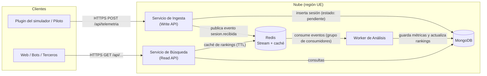
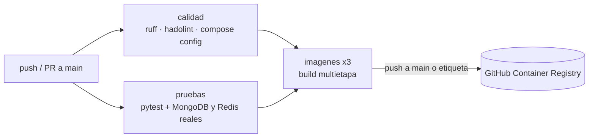

# SimRacing Telemetry — Backend Cloud-Native de análisis de telemetría

Proyecto de prácticas de la asignatura **Cloud Computing: Fundamentos e Infraestructuras** (Máster en Ingeniería Informática, UGR, curso 2026-27).

> **Estado actual:** Hito 2 — Empaquetado Cloud Native, entorno local e integración continua. Ver [cómo arrancarlo en local](#11-entorno-local).

## Índice
1. [Descripción del dominio](#1-descripción-del-dominio)
2. [Casos de uso principales](#2-casos-de-uso-principales)
3. [Justificación NIST SP 800-145](#3-justificación-de-la-arquitectura-nist-sp-800-145)
4. [Mapeo de actores NIST SP 500-292 e impacto económico](#4-mapeo-de-actores-nist-sp-500-292-e-impacto-económico)
5. [Arquitectura de referencia](#5-arquitectura-de-referencia)
6. [Especificación de la API REST](#6-especificación-de-la-api-rest)
7. [Modelo de datos](#7-modelo-de-datos)
8. [Stack tecnológico](#8-stack-tecnológico)
9. [Gestión del proyecto](#9-gestión-del-proyecto)
10. [Hoja de ruta](#10-hoja-de-ruta)
11. [Entorno local](#11-entorno-local)
12. [Contenedores](#12-contenedores)
13. [Integración continua](#13-integración-continua)
14. [Estructura del repositorio](#14-estructura-del-repositorio)

---

## 1. Descripción del dominio

### Problema
Los pilotos de *sim-racing* (simuladores de conducción competitiva como **Assetto Corsa Competizione**, **iRacing**, **Gran Turismo 7**, **Forza Motorsport** o la saga **F1**) generan en cada sesión una gran cantidad de datos: tiempos por vuelta y por sector, condiciones de pista y la configuración mecánica del coche (*setup*: suspensión, aerodinámica, presiones, diferencial, marchas…).

Hoy esos datos se quedan **en local y aislados**: en ficheros del juego o en herramientas de escritorio de un solo usuario. Esto provoca tres problemas:

* **No se puede comparar**: un piloto no sabe si su *setup* es competitivo frente al de otros pilotos con el mismo coche y circuito.
* **No se puede analizar**: saber en qué sector se pierde tiempo o lo regular que es un piloto exige revisar los datos a mano.
* **No se puede compartir**: los equipos y comunidades intercambian *setups* por foros y Discord, sin saber con qué tiempos y en qué condiciones se lograron.

### Solución
Una **aplicación nativa de la nube** que ofrece una API centralizada para:

1. **Recibir** las sesiones de pista que envían los pilotos o los *plugins* de los simuladores (la mayoría de estos juegos emiten telemetría en tiempo real por UDP con formato documentado).
2. **Procesar y enriquecer** cada sesión de forma asíncrona: validar las vueltas, descartar vueltas inválidas o anómalas, calcular la vuelta ideal teórica (suma de los mejores sectores), la consistencia del piloto y una puntuación del *setup*.
3. **Consultar** los datos procesados: ranking de *setups* por coche, circuito y condiciones, detalle de una sesión y comparativa sector a sector entre dos sesiones.

La lógica de negocio está en el **análisis**, no en almacenar y devolver registros, y eso justifica una arquitectura distribuida. La carga es muy irregular: hay ráfagas masivas de escritura al terminar carreras y torneos, mientras que las consultas de lectura son continuas. Por eso se separan escritura, procesamiento y lectura en servicios que escalan de forma independiente.

### Alcance
Para mantener el proyecto dentro de las capas gratuitas del proveedor cloud, el sistema almacena **resúmenes por vuelta** (tiempos por sector, velocidades punta, condiciones y *setup*), no las trazas brutas de telemetría a 60 Hz. Los datos se generarán con un **simulador de telemetría** propio, que imita el formato de salida de estos juegos y se usará también en las pruebas de carga del Hito 5.

## 2. Casos de uso principales

| ID | Actor | Caso de uso |
| :--- | :--- | :--- |
| CU-01 | Piloto / plugin del simulador | Enviar una sesión de pista (vueltas, condiciones y *setup*) al terminar de rodar. |
| CU-02 | Sistema (worker de análisis) | Validar y enriquecer la sesión: vueltas válidas, vuelta ideal, consistencia y puntuación del *setup*. |
| CU-03 | Piloto | Consultar el ranking de *setups* para un coche y circuito, filtrando por condiciones (seco/mojado). |
| CU-04 | Piloto | Consultar el análisis de una de sus sesiones (mejor vuelta, vuelta ideal, sectores débiles). |
| CU-05 | Piloto / equipo | Comparar dos sesiones sector a sector para ver dónde se gana o se pierde tiempo. |
| CU-06 | Operador de la plataforma | Comprobar el estado de cada microservicio y de sus dependencias (*health check*). |

## 3. Justificación de la arquitectura (NIST SP 800-145)

* **Autoservicio bajo demanda:** los pilotos y los *plugins* se autentican y usan la API en cualquier momento para registrar sesiones o consultar análisis, sin que ningún administrador tenga que aprovisionar recursos o dar de alta accesos a mano.
* **Acceso amplio a la red:** la funcionalidad se expone mediante una API REST estándar (HTTP/JSON), utilizable desde *plugins* de simuladores, aplicaciones web, bots de Discord o scripts.
* **Asignación común de recursos (*resource pooling*):** los mismos servicios, la cola de mensajes y la base de datos atienden a todos los pilotos (*multi-tenant*), y la ubicación física de los recursos queda oculta al consumidor.
* **Rápida elasticidad:** la demanda tiene picos muy marcados (fin de carreras, torneos, fines de semana). El servicio de Ingesta y el worker de Análisis escalan horizontalmente durante esos picos y se reducen en horas valle, mientras la Búsqueda mantiene su capacidad. La cola desacopla la recepción del procesamiento, de modo que una ráfaga no tumba el sistema: solo retrasa el análisis.
* **Servicio medido:** se monitorizan el consumo de CPU y memoria de los contenedores, el almacenamiento, el tamaño de la cola y el número de peticiones por usuario. Esto permite ajustar el coste real y aplicar cuotas de uso de la API.

## 4. Mapeo de actores (NIST SP 500-292) e impacto económico

| Actor NIST | Quién es en este proyecto | Rol | Impacto económico |
| :--- | :--- | :--- | :--- |
| **Consumidor** (*Cloud Consumer*) | Pilotos de sim-racing, equipos y aplicaciones de terceros (*plugins*, bots, webs). | Consumen los *endpoints* de escritura y lectura. | Acceso gratuito con cuota limitada (modelo *freemium*). No invierten en infraestructura propia y solo un plan superior para equipos implicaría pago por uso. |
| **Proveedor** (*Cloud Provider*) | El desarrollador del proyecto, que despliega sobre un proveedor IaaS/PaaS de nube pública en una región de la UE. | Diseña, despliega y mantiene los servicios y la persistencia. | Pasa de CAPEX (comprar servidores dimensionados para el pico) a OPEX (pago por uso). El coste se ajusta al tráfico real y la capa gratuita o los créditos de estudiante cubren el desarrollo. El principal gasto variable es el almacenamiento y el tráfico de salida, de ahí que se guarden resúmenes y no trazas brutas. |
| **Intermediario** (*Cloud Broker*) | Proveedor de identidad federada (OAuth de GitHub o Google) y el registro de contenedores (GitHub Container Registry). | Añaden servicios entre consumidor y proveedor: autenticación y distribución de artefactos. | No hay que desarrollar ni mantener un sistema de autenticación propio ni un registro de imágenes. Ambos son gratuitos para este volumen. |
| **Auditor** (*Cloud Auditor*) | Herramientas de observabilidad del proveedor, *health checks* y la auditoría de *drift* con Terraform en el pipeline de CI/CD. | Verifican de forma independiente disponibilidad, latencia, seguridad y que la infraestructura coincide con el código. | Coste bajo (capa gratuita de monitorización) frente al coste de una caída durante un torneo o de una deriva de configuración no detectada. |
| **Operador** (*Cloud Carrier*) | Proveedores de acceso a Internet y la red troncal del proveedor cloud. | Transportan las peticiones entre clientes y la nube. | Sin coste directo para el proyecto, pero el tráfico de salida que factura el proveedor cloud depende del tamaño de las respuestas, así que estas se paginan y se mantienen compactas. |

## 5. Arquitectura de referencia

El sistema sigue un patrón **CQRS ligero** (separación de escritura y lectura) con procesamiento asíncrono mediante cola.



### Componentes

| Componente | Responsabilidad | Escalado |
| :--- | :--- | :--- |
| **Servicio de Ingesta** (Write API) | Autentica, valida el esquema y los rangos lógicos de los datos, guarda la sesión con estado `pendiente` y publica un evento. Responde de inmediato con `202 Accepted`. | Horizontal, según peticiones por segundo. |
| **Worker de Análisis** | Consume eventos de la cola y calcula vueltas válidas, vuelta ideal, consistencia (desviación típica de las vueltas válidas) y puntuación del *setup*. Actualiza la sesión a `procesada` y recalcula el ranking agregado de ese coche y circuito. | Horizontal, según la longitud de la cola. |
| **Servicio de Búsqueda** (Read API) | Expone rankings de *setups*, detalle de sesiones y comparativas sector a sector. Guarda en caché las consultas de ranking más frecuentes. | Horizontal, independiente de la escritura. |
| **MongoDB** | Persistencia de documentos JSON flexibles: cada juego expone parámetros de *setup* distintos. | Volumen persistente / servicio gestionado. |
| **Redis** | *Stream* de eventos entre Ingesta y Análisis, y caché de lecturas de la Búsqueda. | Instancia única (suficiente para el alcance). |

### Protocolos de comunicación

| Origen → Destino | Protocolo | Tipo |
| :--- | :--- | :--- |
| Cliente → Ingesta / Búsqueda | HTTPS + JSON (REST), autenticación con token *Bearer* | Síncrona |
| Ingesta → Redis Stream → Análisis | Protocolo Redis (RESP), `XADD` / `XREADGROUP` | Asíncrona (eventos) |
| Servicios → MongoDB | Protocolo MongoDB (TCP 27017), red interna privada | Síncrona |
| Búsqueda → Redis | Protocolo Redis (RESP), red interna privada | Síncrona (caché) |

Solo la Ingesta y la Búsqueda se exponen al exterior. El worker, MongoDB y Redis quedan en una red privada.

## 6. Especificación de la API REST

Base: `/api`. Todas las respuestas son JSON. Los errores siguen el formato `{"error": "codigo", "detalle": "..."}`.

### Servicio de Ingesta

| Método | Endpoint | Entrada | Respuesta |
| :--- | :--- | :--- | :--- |
| `POST` | `/api/telemetria` | JSON con la sesión: `juego`, `vehiculo`, `circuito`, `condiciones`, `setup`, `vueltas[]` (ver [modelo de datos](#7-modelo-de-datos)). | `202 Accepted` → `{"id_sesion": "...", "estado": "pendiente"}`. `401` sin token, `422` si falla la validación (campos obligatorios o valores fuera de rango). |
| `GET` | `/health` | — | `200 OK` → `{"status": "ok", "service": "ingesta", "dependencias": {"mongodb": "ok", "redis": "ok"}}`. `503` si falla alguna dependencia. |

### Servicio de Búsqueda

| Método | Endpoint | Entrada | Respuesta |
| :--- | :--- | :--- | :--- |
| `GET` | `/api/setups` | Query: `vehiculo`, `circuito` (obligatorios), `juego`, `condiciones` (`seco`/`mojado`), `limite` (por defecto 20). | `200 OK` → lista de *setups* ordenada por puntuación (mejor vuelta válida y consistencia). Lista vacía `[]` si no hay resultados. `400` si falta un parámetro obligatorio. |
| `GET` | `/api/sesiones/{id_sesion}` | — | `200 OK` → sesión con su análisis: estado, mejor vuelta, vuelta ideal, consistencia, vueltas inválidas y sector más débil. `404` si no existe. |
| `GET` | `/api/comparativa` | Query: `sesion_a`, `sesion_b`. | `200 OK` → diferencia de tiempo por sector y en total entre las mejores vueltas de ambas sesiones. `404` si alguna no existe, `409` si aún no están procesadas o no son del mismo circuito. |
| `GET` | `/health` | — | Igual que en Ingesta, con `"service": "busqueda"`. |

## 7. Modelo de datos

Ejemplo de sesión enviada a `POST /api/telemetria`:

```json
{
  "juego": "assetto_corsa_competizione",
  "vehiculo": "porsche_992_gt3_r",
  "circuito": "spa_francorchamps",
  "condiciones": { "pista": "seco", "temp_aire_c": 21, "temp_pista_c": 29 },
  "setup": {
    "presiones_psi": { "di": 27.4, "dd": 27.5, "ti": 27.1, "td": 27.2 },
    "aero": { "ala_trasera": 6, "splitter": 2 },
    "suspension": { "altura_del_mm": 52, "altura_tra_mm": 70, "barra_del": 3, "barra_tra": 2 }
  },
  "vueltas": [
    { "numero": 1, "tiempo_ms": 139470, "sectores_ms": [42110, 59870, 37490], "valida": true },
    { "numero": 2, "tiempo_ms": 138904, "sectores_ms": [41980, 59410, 37514], "valida": true }
  ]
}
```

El identificador del piloto **no se envía en el cuerpo**: se obtiene del token de autenticación y se guarda **seudonimizado** (hash) para cumplir el RGPD.

Resultado del análisis que añade el worker:

```json
{
  "estado": "procesada",
  "analisis": {
    "mejor_vuelta_ms": 138904,
    "vuelta_ideal_ms": 138880,
    "consistencia_ms": 283,
    "vueltas_invalidas": 0,
    "sector_mas_debil": 2,
    "puntuacion_setup": 95.6
  }
}
```

La **puntuación del setup** (0-100) combina un 80 % de ritmo y un 20 % de regularidad. El ritmo vale 1 si la vuelta iguala el récord de ese coche, circuito y condiciones, y baja linealmente hasta 0 en el 107 % del récord. La regularidad es `1 / (1 + consistencia_ms / 1000)`. En el ranking se recalcula contra el récord del conjunto consultado, así que una vuelta nueva más rápida reordena a las demás.

## 8. Stack tecnológico

| Capa | Tecnología | Motivo |
| :--- | :--- | :--- |
| Microservicios | Python 3.13 + FastAPI + Uvicorn | Validación de esquemas con Pydantic y documentación OpenAPI automática (`/docs`). |
| Worker | Python 3.13 + `redis-py` (asyncio) | Mismo lenguaje y modelos compartidos con los servicios. |
| Persistencia | MongoDB 8 (driver asíncrono de PyMongo) | Documentos flexibles para *setups* distintos según el juego. |
| Cola y caché | Redis 7.4 (Streams + claves con TTL) | Un solo componente para eventos y caché, ligero de desplegar. |
| Pruebas y calidad | pytest, ruff, hadolint | Tests unitarios y de integración, linter de Python y de Dockerfiles. |
| Contenedores | Docker + Docker Compose | Entorno local reproducible (Hito 2). |
| Infraestructura | Terraform | Infraestructura como código (Hito 3). |
| CI/CD | GitHub Actions + GitHub Container Registry | Hitos 2 y 4. |
| Pruebas de carga | k6 | Hito 5. |

## 9. Gestión del proyecto

* **Tablero:** [GitHub Projects](https://github.com/users/jjtcUGR/projects/1/views/2), con una vista agrupada por *milestone* (un *milestone* por hito).
* **Historias de usuario:** *issues* con la etiqueta `user-story`, creadas con la plantilla [`.github/ISSUE_TEMPLATE/user_story.md`](.github/ISSUE_TEMPLATE/user_story.md).
* **Pull requests:** con la plantilla [`.github/PULL_REQUEST_TEMPLATE.md`](.github/PULL_REQUEST_TEMPLATE.md).
* **Flujo de trabajo:** ramas y commits según [`docs/flujo-de-trabajo.md`](docs/flujo-de-trabajo.md).
  * `main` siempre estable y protegida; todo cambio entra por *pull request*.
  * Ramas `feat/…`, `fix/…`, `docs/…`, `chore/…` creadas desde `main`.
  * Commits semánticos (*Conventional Commits*): `feat:`, `fix:`, `docs:`, `refactor:`, `test:`, `chore:`.

## 10. Hoja de ruta

| Hito | Contenido | Estado |
| :--- | :--- | :--- |
| 1 | Definición del proyecto, modelo de negocio y arquitectura | Entregado |
| 2 | Contenedores, entorno local con Docker Compose e integración continua | En curso |
| 3 | Infraestructura como código con Terraform y patrón *Reconciler* | Pendiente |
| 4 | Despliegue continuo, auditoría de *drift* en el pipeline, seguridad y RGPD | Pendiente |
| 5 | Observabilidad, pruebas de carga y *release* v1.0.0 | Pendiente |

## 11. Entorno local

Requisitos: Docker Engine con el plugin Compose v2.

```bash
cp .env.example .env          # y cambia las contraseñas
docker compose up -d --build  # levanta los 5 contenedores
docker compose ps             # todos deben aparecer como "healthy"
```

| Servicio | URL | Documentación interactiva |
| :--- | :--- | :--- |
| Ingesta | http://localhost:8001 | http://localhost:8001/docs |
| Búsqueda | http://localhost:8002 | http://localhost:8002/docs |

Para generar datos, el [simulador de telemetría](tools/simulador.py) envía sesiones realistas (varios juegos, coches y circuitos, con vueltas inválidas y anómalas). Solo necesita Python, sin dependencias:

```bash
python tools/simulador.py --token token-dev-piloto-1 --sesiones 50
curl "http://localhost:8002/api/setups?vehiculo=porsche_992_gt3_r&circuito=spa_francorchamps"
```

Los datos de MongoDB y Redis se guardan en los volúmenes `mongo-datos` y `redis-datos`, así que sobreviven a `docker compose down` y `docker compose restart`. `docker compose down -v` los borra.

**Desarrollo sin contenedores:**

```bash
python -m venv .venv && .venv/bin/pip install -r requirements/dev.txt
.venv/bin/pytest                      # pruebas unitarias (las de integración se omiten)
docker compose up -d mongo redis      # para las de integración, con MONGO_URL y REDIS_URL definidas
.venv/bin/ruff check . && .venv/bin/ruff format --check .
```

## 12. Contenedores

Cada componente tiene su propio [`Dockerfile`](services/) y se construye desde la raíz del repositorio (el código común está en `src/simracing/comun`).

| Decisión | Motivo |
| :--- | :--- |
| **Construcción multietapa** | La etapa `dependencias` crea un entorno virtual con los paquetes; la etapa `final` solo copia ese entorno y el código. `pip` queda fuera de la imagen final, igual que las cachés y los ficheros de requisitos. |
| **Imagen base `python:3.13-slim` (Debian trixie), versión exacta fijada** | Mucho más ligera que la imagen completa, que incluye compiladores y cabeceras que no hacen falta en ejecución. Usa glibc, así que pydantic-core y pymongo instalan *wheels* precompilados sin compilar nada. Alpine (musl) obligaría a compilar algunas dependencias y apenas ahorra tamaño. Las imágenes *distroless* dependen de la versión de Python de Debian y no traen shell, lo que complica los health checks y la depuración. |
| **Usuario sin privilegios** | Cada imagen crea el usuario `app` (UID 10001) y se ejecuta con `USER app`. El código pertenece a `root`, así que el proceso puede leerlo pero no modificarlo. |
| **Dependencias mínimas por servicio** | `requirements/base.txt` (Pydantic, PyMongo, Redis) es común. Las APIs añaden `api.txt` (FastAPI, Uvicorn) y el worker no, por lo que su imagen es más pequeña. |
| **Caché de capas** | Primero se copian los requisitos y se instalan, y después el código. Cambiar el código no reinstala las dependencias. Un `.dockerignore` de lista blanca deja fuera del contexto todo lo que no son `requirements/` y `src/`. |
| **Puertos y salud** | Las APIs exponen el puerto 8000 y tienen `HEALTHCHECK` contra `/health`. El worker no expone puertos y su health check (`python -m simracing.analisis.salud`) comprueba MongoDB y Redis. |

En [`compose.yaml`](compose.yaml):
* **Redes:** la red `publica` solo la usan Ingesta y Búsqueda, que son los únicos servicios que publican puertos. MongoDB, Redis y el worker están en la red `interna` (`internal: true`), que no tiene salida al exterior.
* **Volúmenes:** `mongo-datos` y `redis-datos` (Redis con `appendonly` para no perder la cola al reiniciar).
* **Orden de arranque:** los servicios esperan a que MongoDB y Redis estén *healthy* (`depends_on: condition: service_healthy`).
* **Endurecimiento:** los contenedores propios tienen el sistema de ficheros en solo lectura (`read_only` con `/tmp` en memoria), eliminan todas las *capabilities* (`cap_drop: ALL`) y activan `no-new-privileges`.
* **Configuración:** todo llega por variables de entorno desde `.env`. [`.env.example`](.env.example) documenta cada variable sin credenciales reales, y Compose se niega a arrancar si falta alguna obligatoria.

## 13. Integración continua

El workflow [`ci.yml`](.github/workflows/ci.yml) se ejecuta en cada *push* y *pull request* a `main` y en las etiquetas `v*.*.*`:



1. **calidad:** `ruff check` y `ruff format --check` para Python, `hadolint` para los tres Dockerfiles y `docker compose config` para validar el manifiesto.
2. **pruebas:** levanta MongoDB y Redis como *service containers* y ejecuta las pruebas unitarias y de integración con cobertura. Guarda el informe JUnit y el de cobertura como artefactos.
3. **imagenes:** construye en paralelo las tres imágenes con caché de GitHub Actions. En los *pull requests* solo se construyen, para comprobar que funcionan. En `main` y en las etiquetas se publican en `ghcr.io/jjtcugr/simracing-telemetry-<servicio>` con estas etiquetas:
   * `sha-<hash>`: el commit exacto (inmutable).
   * `1.2.3` y `1.2`: la versión semántica, cuando se publica una etiqueta `v1.2.3`.
   * `latest`: el último commit de `main`.

## 14. Estructura del repositorio

```
src/simracing/
  comun/      configuración, modelos Pydantic, cálculos (lógica pura), acceso a MongoDB y Redis, logs JSON
  ingesta/    Write API (FastAPI)
  busqueda/   Read API (FastAPI)
  analisis/   worker de Redis Streams
services/<servicio>/Dockerfile
tests/unit/          pruebas sin dependencias externas (dobles en memoria)
tests/integration/   flujo completo con MongoDB y Redis reales
tools/simulador.py   generador de sesiones de telemetría
compose.yaml · .env.example · requirements/ · .github/workflows/ci.yml
```
